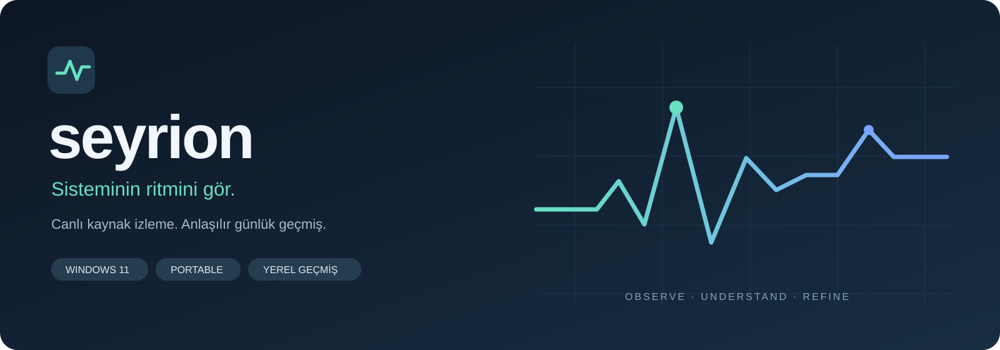

<strong>Türkçe</strong> · <a href="README.en.md">English</a>

# Seyrion

### Sisteminin ritmini gör.

Bilgisayarın ne yapıyor? Kaynakların nereye gidiyor?

Canlı uygulama tüketimi ve günlük geçmiş, aynı sade ekranda.

**[↓ Stabil sürümü indir](https://github.com/Enes-Somuncular/Seyrion-Releases/releases/latest)** &nbsp;·&nbsp; [Beta ve tüm sürümler](https://github.com/Enes-Somuncular/Seyrion-Releases/releases) &nbsp;·&nbsp; [Kurulum](docs/INSTALL.md)

Windows 11 · x64 · Portable · Türkçe · Yerel geçmiş

---

## Bilgisayarındaki hareketi anlaşılır kıl

| Canlı görünüm | Günlük hafıza | Senin kontrolünde |
| :--- | :--- | :--- |
| CPU ve RAM durumunu, uygulamaların tüketimini gör. | Hangi uygulamanın toplamda ne kadar CPU zamanı harcadığını incele. | İzlemeyi duraklat, CSV al, stabil veya beta kanalını seç. |
| Uygulama adına göre filtrele; aynı adlı süreçleri birlikte gör. | Ortalama/tepe özel belleği ve süreç I/O toplamlarını karşılaştır. | Güncellemeyi uygulamadan indir; hazır olduğunda yeniden başlat. |

## İndir · çıkar · aç

1. [Son stabil sürümün](https://github.com/Enes-Somuncular/Seyrion-Releases/releases/latest) **Seyrion-VERSION-win-x64-portable.zip** dosyasını indir.
2. ZIP'in tamamını yazılabilir bir klasöre çıkar.
3. Klasörün kökündeki **Seyrion.exe** dosyasını aç.

Kurulum sihirbazı, yönetici yetkisi veya ayrıca .NET kurulumu gerekmez. Klasördeki dosyaları birlikte tut. Uygulamanın ve `UserData` klasörünün bulunduğu ana portable klasörü taşıyabilirsin.

**Mevcut kullanıcılar:** **Güncellemeler → Şimdi denetle → Güncellemeyi indir → Yeniden başlat ve güncelle**. Her sürümde dosyaları silip yeniden kurman gerekmez.

| Stabil | Beta |
| :--- | :--- |
| Günlük kullanım için yayımlanan sürümler. | Yeni özellikleri erken denemek isteyenler için ön sürümler. |
| [Son stabil sürüm →](https://github.com/Enes-Somuncular/Seyrion-Releases/releases/latest) | [Beta ve sürüm arşivi →](https://github.com/Enes-Somuncular/Seyrion-Releases/releases) |
| Beta paketleri sunulmaz. | Beta paketleri ve daha yeni stabil sürümler sunulur. |

Kanalı uygulamanın **Güncellemeler** bölümünden değiştirebilirsin. Kanal değiştirmek otomatik sürüm düşürmez; daha yeni uygun sürümü bekler. Otomatik denetim açılışta ve 30 dakikada bir yapılır; manuel denetim her zaman kullanılabilir. İndirme ve yeniden başlatma senin kontrolündedir.

## Verilerin seninle kalır

- Ölçümler ve uygulama listesi sunucuya gönderilmez.
- Geçmiş ve tercihler portable ana klasöründeki **UserData** altında tutulur; güncellemede korunur.
- Günlük özetler en fazla **30 gün** saklanır. İzleme kapalıyken veya duraklatılmışken süre birikmez.
- İnternet bağlantısı güncelleme denetimi ve paket indirme için GitHub'a yapılır. Otomatik denetimi kapatabilirsin.

## Şimdi sunduklarımız, sırada olanlar

**Mevcut:** CPU/RAM izleme, uygulama grupları, günlük CPU/bellek/I/O özeti, CSV aktarımı, sistem tepsisi ve portable güncelleme.

**Yol haritası:** GPU ve desteklenen sensörler, watt/enerji görünümü, oyun oturumu özeti, kare süreleri ve kanıta dayalı performans önerileri. Bu özellikler henüz mevcut değildir. [Yol haritası](docs/ROADMAP.md).

Özel bellek, fiziksel RAM tüketimiyle aynı değildir. I/O sayaçları disk/ağ olarak ayrılmaz. Korunan veya kısa ömürlü süreçler eksik kalabilir. Bu ilk dağıtımın uzun süreli ve farklı donanımlarda doğrulaması sürüyor.

İndirme dosyaları ve Windows doğrulaması

**Portable ZIP** ilk kullanım içindir. `.nupkg` ve `releases.*.json` dosyaları uygulama içi güncelleyiciye aittir; elle açman gerekmez. `SHA256SUMS.txt` indirilen dosyaların hash değerlerini içerir.

Uygulama henüz Authenticode sertifikasıyla imzalı değildir; Windows SmartScreen ilk açılışta uyarı gösterebilir. Yalnızca bu resmî depodaki sürümleri kullan. [Kurulum rehberi](docs/INSTALL.md).

Bu depo **ürün belgeleri ve derlenmiş dağıtım** içindir; uygulamanın kaynak kodu özeldir. GitHub'ın otomatik **Source code (zip/tar.gz)** bağlantıları uygulamanın kaynak kodunu içermez ve çalıştırılabilir paket değildir.

---

[Sürümler](https://github.com/Enes-Somuncular/Seyrion-Releases/releases) · [Sorun bildir](https://github.com/Enes-Somuncular/Seyrion-Releases/issues/new/choose) · [Kurulum](docs/INSTALL.md) · [Marka](docs/BRAND.md)

Seyrion · Sisteminin ritmini gör. · Enes Somuncular

